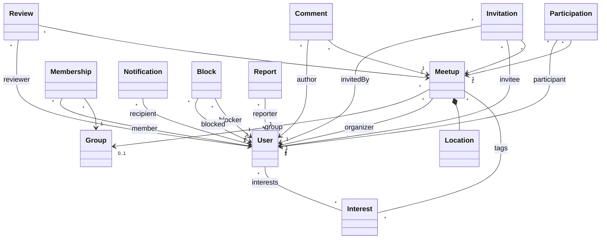

# PlanBe Backend

Backend de **PlanBe**, una plataforma para crear, descubrir y unirse a quedadas entre personas y grupos.

## Visión
PlanBe propone un backend REST (HAL) para gestionar planes sociales con reglas de visibilidad, participación, moderación y recomendaciones personalizadas, siguiendo un enfoque SDD (Spec-Driven Development) con Cucumber.

## Actores del sistema
- **Anónimo**: registro y consulta de quedadas públicas.
- **Usuario**: gestiona perfil, crea quedadas, participa, invita, comenta y valora.
- **Miembro/Admin de grupo**: administra grupos y su participación en quedadas.
- **Admin de plataforma (`ROLE_ADMIN`)**: moderación y gestión avanzada (intereses, reportes, bloqueos).

## Funcionalidades principales
> Estado del repositorio: se listan capacidades existentes y elementos todavía planificados en `docs/PLAN.md`.

- **Usuarios y perfiles**: registro/login, perfil, privacidad de datos personales, intereses.
- **Quedadas**: CRUD, visibilidad, estado, capacidad y validaciones.
- **Participación e invitaciones**: unirse, invitaciones, lista de espera y transiciones de estado.
- **Grupos**: creación/gestión de grupos y membresías con roles.
- **Comentarios**: comentarios sobre quedadas con control de acceso.
- **Valoraciones**: reseñas de participantes sobre quedadas finalizadas.
- **Notificaciones**: bandeja de notificaciones y marcado como leídas.
- **Moderación**: bloqueos entre usuarios y reportes con flujo de revisión.

Funcionalidades planificadas en roadmap (no afirmar como cerradas): recurrencia avanzada de quedadas y chat de quedada.

## Arquitectura y stack
- **Java 21**
- **Spring Boot**
- **Spring Data JPA**
- **Spring Data REST + HAL Explorer**
- **Spring Security (Basic Auth) + BCrypt**
- **Bean Validation**
- **H2 / PostgreSQL**
- **Cucumber + JUnit Platform**

## Restricciones arquitectónicas del proyecto
- Exposición REST principalmente mediante repositorios `@RepositoryRestResource`.
- Reglas de ciclo de vida y seguridad de dominio en handlers `@RepositoryEventHandler`.
- Autorización a nivel de fila con SpEL en consultas `@Query`.
- Endpoint auxiliar de identidad autenticada: `GET /identity`.

## Modelo de dominio (resumen)

## Endpoints principales
### Recursos
`/users`, `/interests`, `/meetups`, `/participations`, `/invitations`, `/groups`, `/memberships`, `/comments`, `/reviews`, `/notifications`, `/blocks`, `/reports` y `/identity`.

### Búsquedas disponibles (Spring Data REST)
- `/users/search/findByIdContaining`
- `/interests/search/findByName`
- `/interests/search/findByNameContainingIgnoreCase`
- `/meetups/search/findVisibleMeetups`
- `/meetups/search/findByCategoryAndVisibility`
- `/meetups/search/findByCityAndVisibility`
- `/meetups/search/findByStartDateAfterAndVisibility`
- `/meetups/search/findByOrganizerAndVisibility`
- `/meetups/search/recommended`
- `/groups/search/findByOwnedBy`
- `/groups/search/findByName`
- `/memberships/search/findByGroupId`
- `/notifications/search/findUnread`
- `/reports/search/findByStatus`
- `/reviews/search/findByReviewerIdAndMeetupId`
- `/reviews/search/findByMeetupId`

Referencia funcional completa y objetivo de endpoints: [`docs/PLAN.md`](docs/PLAN.md).

## Requisitos y ejecución con Maven
### Requisitos
- JDK **21**
- Maven 3.9+

### Comandos
- Ejecutar aplicación (perfil por defecto):
  - `mvn spring-boot:run`
- Ejecutar aplicación con PostgreSQL (`DATABASE_URL` + perfil `postgres`):
  - `mvn spring-boot:run -Dspring-boot.run.profiles=postgres`
- Ejecutar tests:
  - `mvn test`
- Ejecutar suite BDD Cucumber:
  - `mvn test -Dtest=CucumberTest`

## Roadmap SDD (basado en `docs/PLAN.md`)
| Iteración | Objetivo | Estado en repositorio |
|---|---|---|
| 0 | Registro/login base | Implementado |
| 1 | Perfil e intereses | Implementado |
| 2 | Gestión de quedadas | Implementado |
| 3 | Participación y aforo/lista de espera | Implementado |
| 4 | Invitaciones | Implementado |
| 5 | Grupos y membresías | Implementado |
| 6 | Comentarios | Implementado |
| 7 | Valoraciones | Implementado |
| 8 | Notificaciones | Implementado |
| 9 | Recomendaciones | Implementado |
| 10 | Moderación (bloqueos/reportes) | Implementado |
| 11 | Recurrencia de quedadas | Planificado |
| 12 | Chat de quedada | Planificado |

## Documentación relacionada
- Plan funcional y roadmap: [`docs/PLAN.md`](docs/PLAN.md)
- Flujo de desarrollo asistido por IA: [`AI_DEVELOPMENT_GUIDE.md`](AI_DEVELOPMENT_GUIDE.md)
- Convenciones del repositorio: [`CONVENTIONS.md`](CONVENTIONS.md)
- Guía de agentes: [`AGENTS.md`](AGENTS.md)
- Ayuda adicional: [`HELP.md`](HELP.md)
- Licencia: [`LICENSE`](LICENSE)
